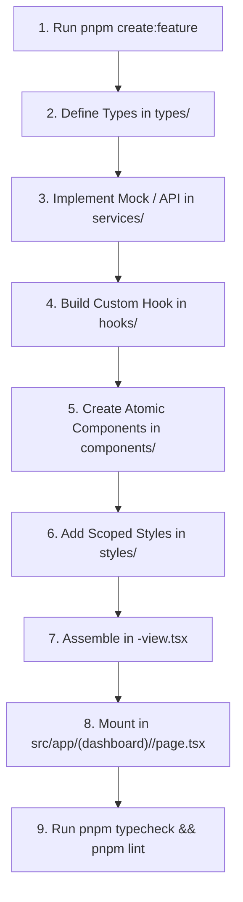

# Architecture & Navigation Guide — AMS Client

This document is the definitive engineering manual for **both human developers and AI agents** working on the Academy Management System client (`ams-client`). It details how the codebase is organized, how to navigate between layers, and the strict conventions required when extending or maintaining features.

---

## 1. Quick Navigation: Where to Find Everything

| Need | Directory / File | Description |
| :--- | :--- | :--- |
| **Routes & Pages** | `src/app/(dashboard)/.../page.tsx` | Next.js App Router entrypoints (lean wrappers) |
| **Feature Domain Code** | `src/features/<feature>/` | Self-contained business features (7-part standard) |
| **Shared Primitives** | `src/components/ui/` | Headless/styled atoms: Button, Badge, Card, Input, Modal |
| **Shell & Layout** | `src/components/layout/` | App shell, collapsible Sidebar, Topbar |
| **Design Tokens** | `src/styles/tokens.css` | Generated `--ams-*` variables (colors, spacing, radii) |
| **Global Typography** | `src/app/fonts.ts` & `src/app/fonts/` | Local Inter variable font assets |
| **Global Utilities** | `src/lib/` | Reusable utilities such as `touch-ripple.ts` |
| **Global Types** | `src/types/` | Cross-feature declarations and environment types |
| **Feature Scaffolder** | `scripts/create-feature.mjs` | Generator for standard feature modules |

---

## 2. Architectural Blueprint: Feature-Sliced Design

The codebase uses an adapted **Feature-Sliced Design (FSD)** pattern. Every domain feature lives inside `src/features/<feature-name>/` and **must strictly adhere to an identical 7-part contract**:

```
src/features/<feature-name>/
├── components/           # Flat atomic UI components & view coordinator (NO nested subfolders)
│   ├── <feature>-view.tsx       # Slim coordinator component (~100-200 lines)
│   ├── <atomic-component-a>.tsx # Single-responsibility atomic widget
│   ├── <atomic-component-b>.tsx # Single-responsibility atomic widget
│   └── index.ts                 # Components barrel export
├── hooks/                # Feature custom React hooks
│   ├── use-<feature>.ts         # Primary state and interaction logic
│   └── index.ts                 # Hooks barrel export
├── lib/                  # Pure utility functions & domain helpers
│   ├── <feature>-utils.ts       # Formatters, calculators, validators
│   └── index.ts                 # Lib barrel export
├── services/             # Data access layer, API handlers, mock fixtures
│   ├── <feature>.service.ts     # Data fetching and mutation functions
│   └── index.ts                 # Services barrel export
├── styles/               # Dedicated CSS Modules folder
│   ├── <feature>-view.module.css # Styles for coordinator
│   ├── <component-a>.module.css  # Styles for atomic component A
│   └── <component-b>.module.css  # Styles for atomic component B
├── types/                # Domain models, interfaces, and constants
│   ├── <feature>.types.ts       # TypeScript types and enums
│   └── index.ts                 # Types barrel export
└── index.ts              # Public feature entrypoint re-exporting all submodules
```

### Active Feature Modules
1. **`dashboard`** (`src/features/dashboard`): Admin overview metrics, interactive bar/donut charts, activity feeds, and quick actions.
2. **`branches`** (`src/features/branches`): Multi-branch directory, branch stats, search/filter controls, and action modals.
3. **`create-branch`** (`src/features/create-branch`): Multi-section branch onboarding flow (details, assignments, social profiles).

---

## 3. The 6 Core Engineering Rules

### Rule 1: Clean App Router (`src/app/`)
- **NO CSS modules inside `src/app/`**: Route folders contain only Next.js convention files (`page.tsx`, `layout.tsx`, `not-found.tsx`, `loading.tsx`, `error.tsx`).
- `page.tsx` must be a lean Server/Client component whose sole responsibility is importing and rendering the feature view coordinator:
  ```tsx
  // src/app/(dashboard)/branches/page.tsx
  import { BranchesView } from "@/features/branches";

  export default function BranchesPage() {
    return <BranchesView />;
  }
  ```

### Rule 2: Atomic Components Principle (No Giant Files)
- **NEVER** write single files with 800–1000+ lines of code.
- Decompose complex interfaces into atomic, focused components with single responsibilities (e.g. `branch-table.tsx`, `branch-filters.tsx`, `branch-pagination.tsx`).
- Keep coordinator files (`<feature>-view.tsx`) lightweight (~100–250 lines), assembling atomic parts.
- Components directory must remain **flat**: Do not create subdirectories inside `components/` (e.g. use `branch-stats-card.tsx` directly in `components/`, never `components/cards/branch-stats-card.tsx`).

### Rule 3: Dedicated CSS Module Folder (`styles/`)
- Every feature must house all its CSS modules inside `src/features/<feature>/styles/`.
- Component files import their scoped styles from `../styles/<component>.module.css`.
- Avoid co-locating `.module.css` files alongside `.tsx` files inside `components/`.

### Rule 4: Design Tokens as Single Source of Truth
- **Never** introduce arbitrary hex colors in CSS files or inline styles.
- Always use variables from `src/styles/tokens.css`:
  - **DSCA Emerald Brand:** `#028c4a` (`--ams-color-brand-dsca`)
  - **GBTA Vibrant Orange:** `#ff7724` (`--ams-color-brand-gbta`)
  - **Primary Action Blue:** `#1b84ff` (`--ams-color-primary-300`)
  - **Primary Text:** `#071437` (`--ams-color-grayscale-400`)
  - **Muted Text:** `#99a1b7` (`--ams-color-grayscale-300`)
  - **Surface Page:** `#ffffff` / `#f4f6fa` (`--ams-color-surface-page`)
  - **Subtle Borders:** `#eff1f4` (`--ams-color-border-subtle`)
- For interactive feedback, integrate Material UI-style ripples using `@/lib/touch-ripple`.

### Rule 5: Scaffolding Automation
Whenever starting a new feature, **always** run the feature generator to produce the standardized 7-part module:
```bash
npm run create:feature <feature-name>
# or
pnpm create:feature <feature-name>
```
*Example:* `pnpm create:feature student-management` scaffolds `src/features/student-management/` complete with boilerplate components, hooks, lib, services, styles, types, and index barrels.

### Rule 6: Absolute Visual Preservation
- **Never** alter existing layouts, spacing, font sizes, colors, or visual behaviors unless the user explicitly requests a redesign.
- Always verify changes visually across Desktop (1440px+), Laptop (1024px–1439px), and Tablet/Mobile viewports.

---

## 4. How to Implement a New Feature: Step-by-Step

Follow this systematic workflow whenever adding or modifying functionality:



### Step 1: Scaffold Feature
```bash
pnpm create:feature courses
```

### Step 2: Define Domain Types (`types/`)
Define interfaces, statuses, and form values in `src/features/courses/types/courses.types.ts` and export them through `types/index.ts`.

### Step 3: Implement Data Layer (`services/`)
Create mock datasets or API client functions in `src/features/courses/services/courses.service.ts`.

### Step 4: Encapsulate State & Logic (`hooks/`)
Write the feature hook in `src/features/courses/hooks/use-courses.ts` returning state, handlers, and filters.

### Step 5: Build Atomic Components & Styles (`components/` & `styles/`)
Create small, focused visual components:
- `components/courses-table.tsx` -> styles in `styles/courses-table.module.css`
- `components/courses-filter-bar.tsx` -> styles in `styles/courses-filter-bar.module.css`

### Step 6: Assemble the Feature View
In `components/courses-view.tsx`, wire the hook to the atomic components.

### Step 7: Create the Next.js Route
Create `src/app/(dashboard)/courses/page.tsx`:
```tsx
import { CoursesView } from "@/features/courses";

export const metadata = {
  title: "Courses | AMS",
  description: "Manage academy courses and schedules",
};

export default function CoursesPage() {
  return <CoursesView />;
}
```

### Step 8: Quality Gate Verification
Always execute:
```bash
pnpm typecheck   # Must return 0 errors (tsc --noEmit)
pnpm lint        # Must return 0 warnings/errors (eslint)
```

---

## 5. Shared Design System & UI Primitives

All common, cross-feature components live in `src/components/`:
- **`src/components/ui/`**: Base UI wrapped atomic primitives:
  - `button.tsx`: Buttons with variants (`primary`, `secondary`, `outline`, `ghost`, `danger`) and touch ripple support.
  - `badge.tsx`: Pill indicators for statuses (`success`, `warning`, `neutral`, `info`).
  - `card.tsx`: Surface containers with standardized padding and elevation.
  - `input.tsx`: Text inputs and form controls.
  - `modal.tsx`: Accessible dialog overlays.
- **`src/components/layout/`**: Shell elements:
  - `sidebar.tsx`: Collapsible navigation sidebar.
  - `topbar.tsx`: Header with academy selector, user profile, and search.
  - `dashboard-shell.tsx`: Responsive layout container.
- **`src/components/not-found/`**: Beautiful 404 illustration and recovery view.

---

## 6. Verification Checklist Before Concluding Any Task

Before committing or completing any AI agent turn, confirm:
- [ ] Feature files strictly follow the 7-part structure (`components`, `hooks`, `lib`, `services`, `styles`, `types`, `index.ts`).
- [ ] No `.module.css` files exist inside `src/app/`.
- [ ] All feature CSS modules are located inside `src/features/<feature>/styles/`.
- [ ] No file exceeds single-responsibility size (atomic components used throughout).
- [ ] `pnpm typecheck` returns exit code 0.
- [ ] `pnpm lint` returns exit code 0.
- [ ] Visual fidelity matches brand specifications and existing UI layouts.
